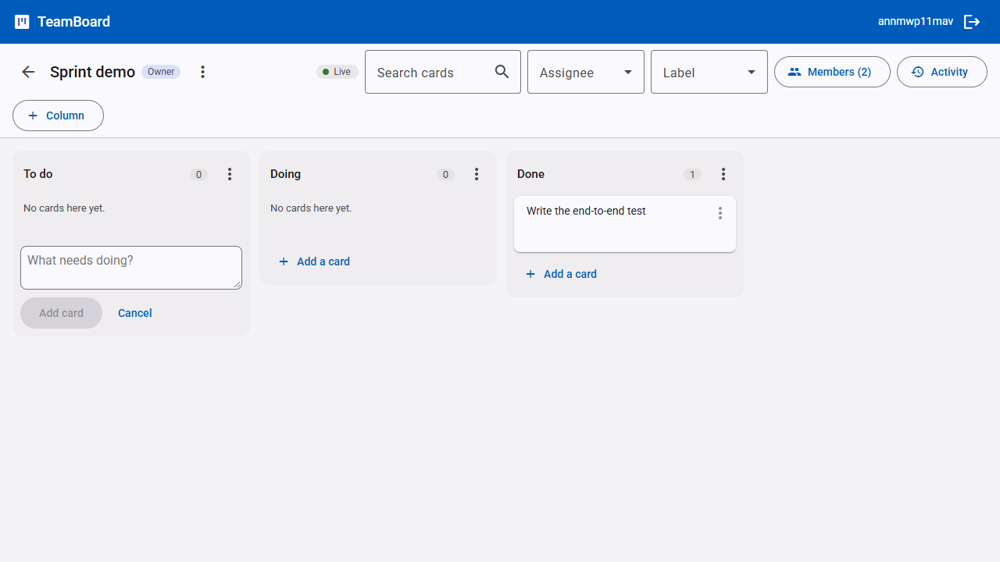
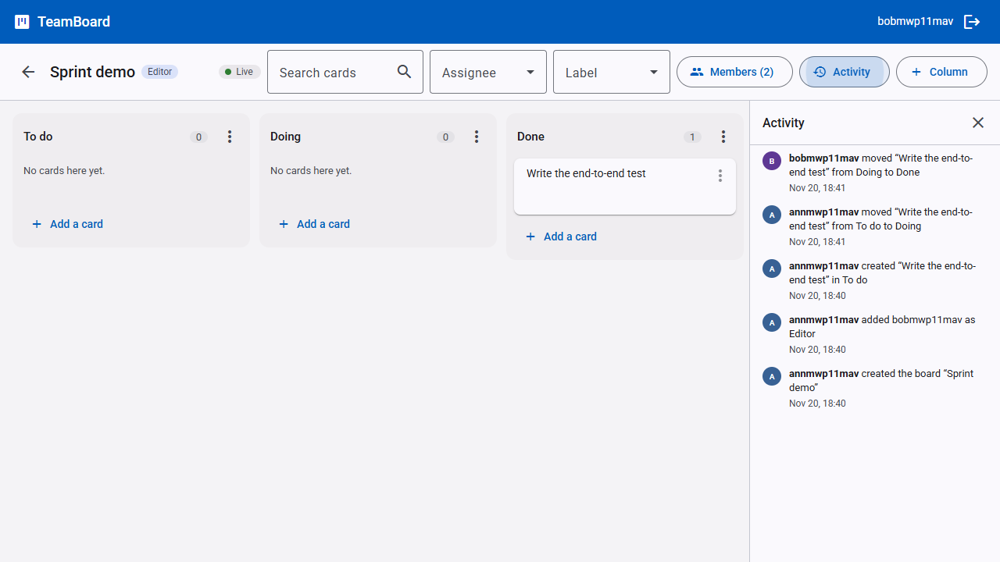

# TeamBoard

[](https://github.com/Taha-Hassan-1/TeamBoard/actions/workflows/ci.yml)

A real-time collaborative kanban board. Teams create boards, invite people with Viewer, Editor or Owner roles, and drag cards between columns; everyone looking at a board sees changes the moment they happen. ASP.NET Core 10 Web API with hand-built token authentication and SignalR, EF Core on SQL Server, and an Angular front end with a generated API client.

**Live demo:** <https://teamboard-taha.thankfulgrass-8dcd7388.centralus.azurecontainerapps.io> (Azure Container Apps plus Azure SQL's free offer; see [docs/DEPLOY.md](docs/DEPLOY.md)). It scales to zero when idle, so the first visit after a quiet spell can take about a minute to wake. A GIF of two browsers syncing is still to be recorded; until then, these two screenshots are Ann's and Bob's browsers after Ann added a card and dragged it, and Bob moved it on, without either page reloading:

| Ann | Bob |
|---|---|
|  |  |

## What it does

- **Boards, columns, cards** with labels, assignees, priorities, due dates and comments; drag and drop (and a keyboard "move to column" menu); search and filter; soft WIP limits.
- **Live updates.** A second browser sees a card appear, change and move without reloading; an activity feed shows who did what; the connection survives drops and catches up on reconnect.
- **Concurrent edits are handled, not ignored.** Two people editing the same card get a clear choice instead of a silent overwrite.
- **Permissions on every board.** Viewers read, Editors change cards, Owners manage members; a non-member cannot even tell a board exists.
- **Secure by construction.** Short-lived tokens in memory, rotating refresh tokens that detect theft, a strict Content-Security-Policy, rate limits, no secrets in the repository.

## The numbers

Measured here, reproducible with the commands in [docs/PERFORMANCE.md](docs/PERFORMANCE.md) (local machine, so not a deployed figure):

| | |
|---|---|
| Load a 500-card board | **10 ms** p50 (a first-draft `Include` graph took 5,085 ms) |
| 50 users on that board for 30 s | **p95 36 ms**, 231 requests per second, 0 errors |
| Move a card | 6 SQL statements, one row written, p95 9 ms |
| A live move reaching 50 clients | 44 ms p50; the message is 122 bytes instead of the 243 KB board |
| First visit | 137 kB transferred; boards and the card drawer load lazily |
| Tests | 224 backend (real SQL Server), 128 front-end, 2 browser tests |

## Run it

You need the .NET 10 SDK, Node 22.12 or newer, and SQL Server (Express is fine).

```powershell
# API. dotnet run applies the migrations to the configured database in Development.
cd TeamBoard.API
dotnet user-secrets set "Jwt:Key" "<at least 32 random characters>"
dotnet user-secrets set "ConnectionStrings:DefaultConnection" "<SQL Server connection string>"
dotnet run --launch-profile http          # http://localhost:5020, API explorer at /scalar

# Angular app, in a second terminal. It proxies /api and /hubs to the API, so there is no CORS to set up.
cd client
npm install
npm start                                 # http://localhost:4200
```

Everything in one container (see [docs/DEPLOY.md](docs/DEPLOY.md); written but not yet run here):

```powershell
Copy-Item .env.example .env               # fill in SQL_PASSWORD and JWT_KEY
docker compose up --build                 # http://localhost:8080
```

On an older npm (11.1 crashes on some installs) use `npx -y npm@11.6.2 install`.

## Tests

```powershell
dotnet test TeamBoard.slnx              # API, permission matrix, migrations, hub, hardening (needs SQL Server)
cd client; npm test -- --no-watch         # Angular unit tests
cd client; npm run e2e                    # two real browsers on the built app (uses your installed Chrome)
$env:PERF = "1"; dotnet test TeamBoard.Tests --filter Performance   # the measurements (opt-in)
node loadtest/load.mjs                    # 50-user load test against a running API
```

CI runs the first three plus the image build on every push.

## How it is put together

```
TeamBoard.API/   feature folders: Auth, Boards, Columns, Tasks, Comments, Activity, Realtime, Infrastructure
TeamBoard.Tests/ unit, integration on a real SQL Server, hub, permission matrix, performance
client/            Angular app, Playwright tests, and the OpenAPI document the API client is generated from
loadtest/  docs/  Dockerfile  docker-compose.yml
```

- [Architecture](docs/ARCHITECTURE.md): the pieces, the request pipeline, the data model, authentication, live updates, with diagrams.
- [Decision records](docs/decisions/README.md): fifteen short records of what was chosen, why, what was rejected and what happened.
- [Performance](docs/PERFORMANCE.md): the measurements, with the SQL and the query plan.
- [Debugging notes](docs/DEBUGGING.md): eight real bugs, how each was found and what keeps it fixed.
- [Deployment](docs/DEPLOY.md): configuration, release steps, health checks, and what is still to do.
- [Where each skill shows up](docs/RESUME.md), for anyone reading this as a portfolio piece.

### The API contract

`client/openapi.json` is the contract. The TypeScript client in `client/src/app/api` is generated from it and never edited by hand. After changing the API run `npm run api:update` in `client/`; a backend test fails if the document is stale and CI fails if the generated client is.

## Status

All seven milestones of the plan are built and tested (M0 to M6). It is deployed (see the live demo above). **Not done:** the two-browser GIF, a deployed load test at the full 50 users (run with 8, see [docs/PERFORMANCE.md](docs/PERFORMANCE.md)), and live updates assume a single app instance. [docs/DEPLOY.md](docs/DEPLOY.md) has the checklist.
