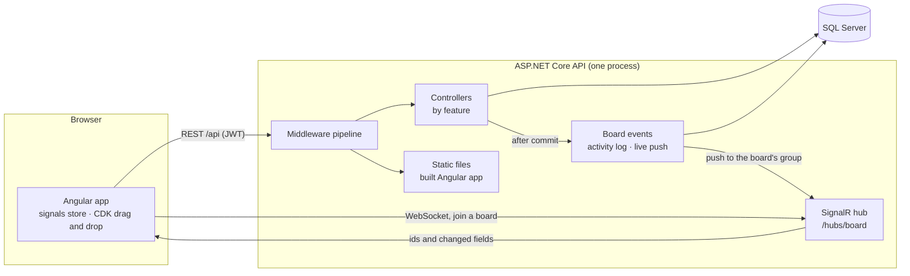
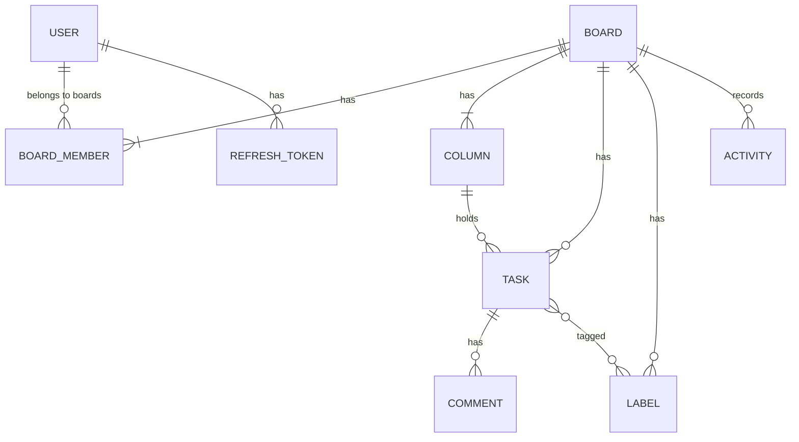
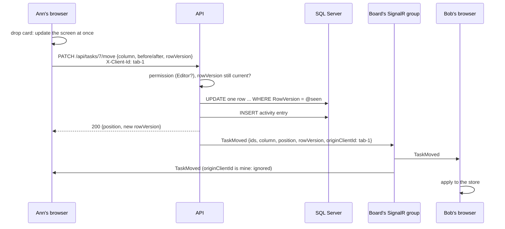
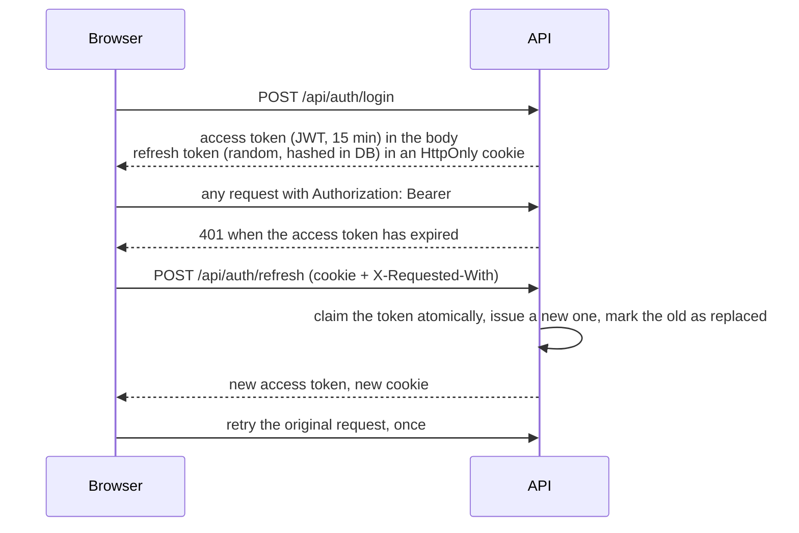

# Architecture

TeamBoard is one ASP.NET Core API and one Angular app. In production the API also serves the built Angular files, so there is one thing to deploy and no CORS. This document says how the pieces fit and why; the individual choices are in [the decision records](decisions/README.md).



## Layout

```
TaskManager.slnx
TaskManager.API/            one project, organised by feature
  Auth/                     register, login, refresh, logout, token service, options
  Boards/                   boards and members
  Columns/  Tasks/  Comments/  Activity/
  Realtime/                 the hub, group membership, the broadcaster
  Infrastructure/           board permissions, events, position strategy, hardening, JSON config
  Data/  Models/  Migrations/
TaskManager.Tests/          unit, integration (real SQL Server), hub and permission-matrix tests
client/                     Angular app, its Playwright tests, and the OpenAPI document it is generated from
loadtest/  docs/  Dockerfile  docker-compose.yml
```

## Backend: feature slices, `DbContext` used directly

A controller action is the handler for its request: it checks permission, does the work with the `DbContext`, publishes an event and returns a DTO. There is no repository layer, because `DbContext` already is a repository and a unit of work (the GameVault project in the same portfolio shows the repository pattern, so the two repos show both). Logic that needs its own tests is pulled out into small classes: `GapPositionCalculator`, `BoardAccessHandler`, `TokenService`, `AuthService`.

| Pattern | Where | What it buys |
|---|---|---|
| Feature slices | one folder per feature | change one feature without touching the others |
| Resource-based authorization | `BoardAccessHandler` (`Infrastructure/BoardAccess.cs`) | one place decides who may do what on a board; controllers say `BoardAccess.Editor`, never a role string |
| Observer | `IBoardEventHandler`: `ActivityLogHandler`, `SignalRNotifier` | the code that moves a card knows nothing about history or live updates; adding a listener is one line in `BoardServiceCollectionExtensions` |
| Strategy | `IPositionCalculator` | the ordering rule can change without touching the move handlers |
| Middleware pipeline | `Infrastructure/WebHardening.cs` | correlation id, exception handling, security headers, compression stay out of the controllers |
| Options, validated at startup | `JwtOptions`, `RefreshOptions`, `RateLimitOptions` | bad configuration fails at boot with a clear message, not on the first login |

### The pipeline, in order

1. Forwarded headers (only if `ForwardedHeaders:Enabled`)
2. Correlation id: one per request, in the response header, in every log line, in every `ProblemDetails`
3. Exception handler: an unhandled exception becomes a `ProblemDetails` with the correlation id; the cause is logged, nothing is leaked
4. HSTS and the HTTPS redirect (outside development)
5. Security headers, then response compression
6. Request logging (Serilog; JSON in production)
7. The built Angular files, with cache rules
8. Routing, then authentication, authorization, the auth rate limiter
9. Controllers, the hub, health checks; the SPA fallback is mapped last

The order matters in two places that cost debugging time (see [DEBUGGING.md](DEBUGGING.md)): static files must come *before* routing, or the fallback endpoint matches first and no file is ever served; and the explicit `UseRouting()` call is what makes that possible.

## Data model



- `BoardMember.Role` is Viewer, Editor or Owner, and a filtered unique index allows exactly one Owner per board.
- A card's order is a `double Position` with a `RowVersion`. A move updates one row; a stale `RowVersion` is a 409.
- `Activity` is append-only and refers to a card by plain id (no foreign key), so history outlives a deleted card.
- Every `DateTime` is UTC and says so on the wire (`ConfigureConventions` in `AppDbContext`).
- Deleting a board cascades down the tree. Every foreign key to `User` is `Restrict` except refresh tokens, because SQL Server rejects schemas with several cascade paths.

## One card move, end to end



If the `UPDATE` finds a different `RowVersion` (Bob moved the same card a moment earlier) the API answers 409, Ann's card snaps back with an explanation, and her screen re-reads the card so a retry can succeed. Both versions are logged, which makes the race easy to reproduce.

## Authentication



- The access token lives **in memory only**. A reload starts without one and gets a new one from the cookie, so XSS cannot read a long-lived credential from storage.
- Refresh tokens are 32 random bytes, stored as SHA-256 hashes, valid 7 days, rotated on every use. If a token that was *already rotated* turns up again, it was copied: all of that user's tokens are revoked. Two simultaneous refreshes with one token cannot both win (an atomic `UPDATE ... WHERE RevokedAt IS NULL`).
- The refresh cookie is `HttpOnly; Secure; SameSite=Strict; Path=/api/auth`, and the endpoint also requires a custom header, so a cross-site form cannot call it.
- Passwords: BCrypt, work factor 12, 10 to 72 characters (72 is BCrypt's limit; longer would be silently truncated). Login does a dummy hash check for unknown emails so a miss takes as long as a wrong password, and both answer 401 with the same body.
- Issuer, audience, signature, algorithm (HS256 only) and lifetime are validated on every token, with a minute of clock skew.

## Live updates

- Clients only **listen**. Every change is a REST call, so validation and permissions exist in one place; the hub pushes the result afterwards.
- `JoinBoard(id)` re-checks membership on every join. "No such board" and "not your board" give the same error, so ids cannot be probed. Removing a member cuts their connections off the group.
- Messages carry ids and changed fields. A browser cannot set headers on a WebSocket, so the token travels as `?access_token=`, accepted for `/hubs` only.
- **Echo suppression:** each tab sends `X-Client-Id`; the API puts it in the message about that change; a tab skips messages that carry its own id. Two tabs of one user are two clients.
- **Reconnect:** after a drop the client rejoins the board (groups do not survive a new connection) and reloads it once, so messages missed while away cannot leave the screen stale. A live message about a card whose move is still in flight is held back and the card re-read afterwards, so a push can never undo an optimistic move.

### Scaling

Groups and the connection registry (`BoardConnections`) are in memory, so live updates assume **one app instance**. More than one needs a SignalR backplane (Redis, or Azure SignalR Service) and the registry in shared storage. REST alone scales out freely; only the live push does not.

## Front end

`client/src/app`:

```
api/            generated from openapi.json: models and one function per endpoint. Never edited by hand.
core/           auth service, interceptor, guards, TeamBoardApi (the only caller of the generated code),
                realtime (hub link, client id, message types), error handling
features/       auth/  boards/  board/ (store, sync, page, card drawer, activity panel, dialogs)
shared/         avatar, label chip, dialogs
```

- **One store per board screen** (`BoardStore`, signals). REST responses and live messages both write into it; components read computed signals and never mutate them.
- **Optimistic moves:** the store updates first, then calls the API; on any failure the card snaps back and the user is told why. Positions are computed with the same gap rule as the server, so the guess is the answer.
- **Everything external goes through an interface a test can replace:** `TeamBoardApi` wraps the generated client; `HubLink` wraps SignalR. Tests drive "a message arrives", "the connection drops" and "the server answers 409" with plain fakes.
- Keyboard users can do everything dragging does through each card's "Move to column" menu.

## Security summary

| Concern | Measure |
|---|---|
| Credentials | BCrypt; JWT access token in memory only; refresh token hashed at rest and rotated |
| CSRF | `SameSite=Strict` cookie scoped to `/api/auth`, plus a custom header on the two cookie-authenticated endpoints; bearer tokens are not sent by browsers automatically |
| XSS | strict Content-Security-Policy (`script-src 'self'`, no inline scripts; `connect-src 'self'`); Angular's template escaping |
| Transport | HTTPS redirect, HSTS for a year (production), TLS ends at the platform's proxy |
| Headers | `nosniff`, `X-Frame-Options: DENY` and `frame-ancestors 'none'`, `Referrer-Policy`, `Permissions-Policy`, `Cache-Control: no-store` on `/api` |
| Authorization | resource-based; non-members get 404 so board ids cannot be probed |
| Abuse | per-IP, per-endpoint rate limit on register, login, refresh and logout; size limits on every text field |
| Secrets | none in the repository; user-secrets in development, environment variables elsewhere; startup fails if they are missing |
| Compression | on over HTTPS. BREACH needs a secret and attacker-chosen text in one compressed response, sent with the victim's credentials by a cross-site request; here the credential is a bearer token that a cross-site page cannot attach, and the cookie endpoint needs a custom header |

**Known limitation, in the CSP:** `style-src` includes `'unsafe-inline'` because Angular Material injects component styles as inline `<style>` elements. Script execution, the dangerous part, is not weakened. Removing it needs a per-request nonce (`ngCspNonce`) and an `index.html` the server rewrites.
